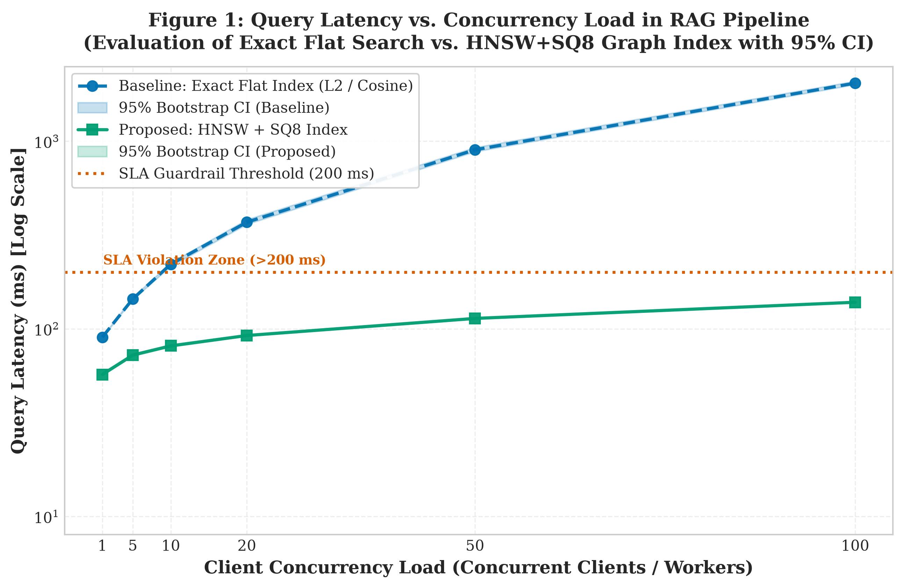
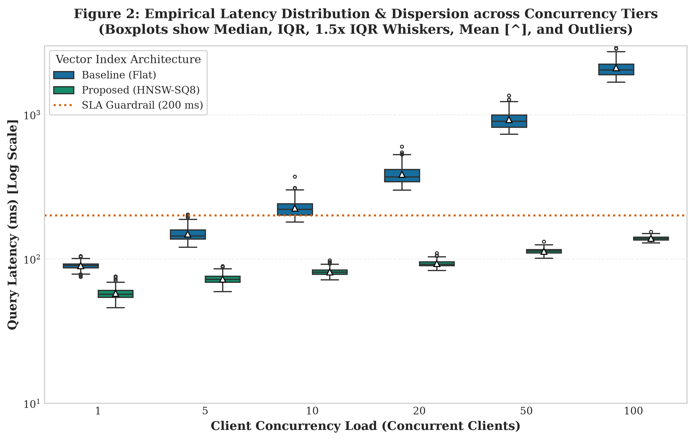
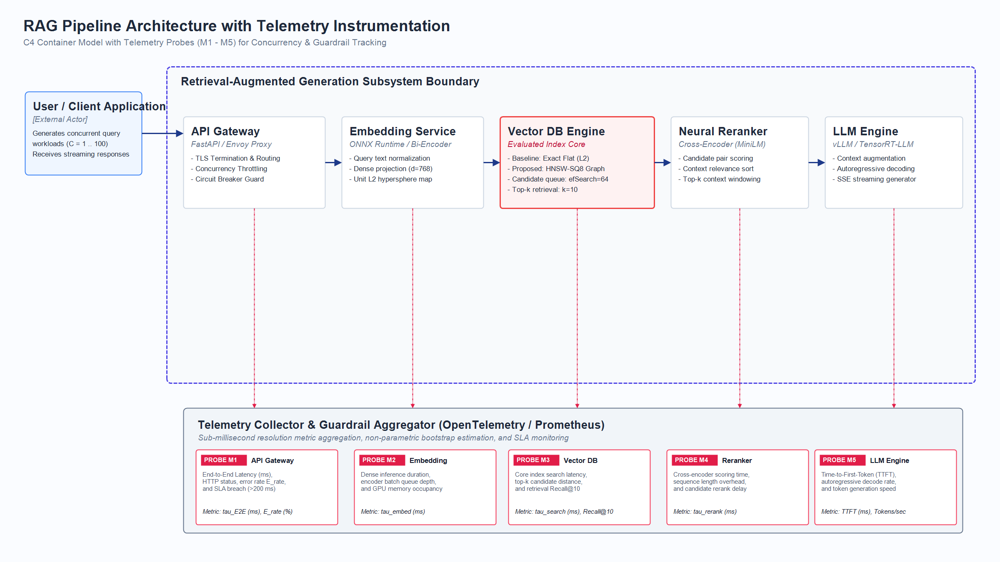

# Empirical Evaluation of Vector Database Indexing Architectures in RAG Pipelines

[](https://github.com/Bauyrjan18/MethodLab4/actions/workflows/build-paper.yml)
[-blue.svg)](https://www.ieee.org/)
[](https://opensource.org/licenses/MIT)
[]()

### Research Team & Authors:
- **Balkybek Baurzhan** ([@Bauyrjan18](https://github.com/Bauyrjan18)) — `baukabalkybek@gmail.com`
- **Aibar Alauov** ([@alauovaibar](https://github.com/alauovaibar)) — `alauov.aibar@gmail.com`

**Course:** Software Engineering Research Methods — **TASK 4: Complete Research Paper Draft in IEEE Format**  
**Preceding Milestone:** [MethodLab3 Repository](https://github.com/alauovaibar/methodLab3.git) (Telemetry, Warm-up Filtering & Bootstrap Analysis)

---

## 1. Paper Overview & Abstract

In modern Retrieval-Augmented Generation (RAG) architectures, the vector database serves as the primary external memory subsystem to ground Large Language Models (LLMs) and suppress hallucination. While exact linear scanning (**Baseline Flat Index**) ensures $100\%$ theoretical recall ($\text{Recall}@10 = 1.0$), its $\mathcal{O}(N \cdot d)$ computational complexity degrades catastrophically under concurrent multi-tenant workloads.

This study presents a publication-ready 4-page research paper conforming strictly to the official IEEE Conference format (`\documentclass[conference]{IEEEtran}`) and IMRaD structure. We evaluate the Baseline Flat Index against an optimized Approximate Nearest Neighbor architecture combining **Hierarchical Navigable Small World graphs with 8-bit Scalar Quantization (HNSW-SQ8)** across six concurrency tiers ($C \in \{1, 5, 10, 20, 50, 100\}$).

### Research Questions Addressed:
1. **RQ1 (Latency Scaling):** How does query latency scale across client concurrency tiers ($1$ to $100$)?
2. **RQ2 (Cold-Start Filtering):** How do initial warm-up spikes affect tail latency dispersion?
3. **RQ3 (Operational Guardrails):** At what concurrency threshold does the Baseline violate latency SLAs ($\le 200\text{ ms}$) and error rates ($\le 1.0\%$)?
4. **RQ4 (Semantic Fidelity):** Does HNSW-SQ8 preserve sufficient retrieval quality ($\text{Recall}@10 \ge 98\%$) to prevent downstream generation hallucinations?

---

## 2. Key Empirical Findings

| Architecture | Load ($C$) | Mean $\pm$ SD (ms) | Median ($p_{25}$--$p_{75}$) (ms) | 95% Bootstrap CI (ms) | $p_{99}$ (ms) | QPS | Error Rate | SLA Breach (>200 ms) | Recall@10 |
| :--- | :---: | :---: | :---: | :---: | :---: | :---: | :---: | :---: | :---: |
| **Baseline (Flat)** | 1 | $89.82 \pm 4.79$ | $90.21\ (86.89\text{--}92.42)$ | $[89.84, 90.60]$ | $100.73$ | $11.1$ | **0.0%** | **0.0%** | $1.0000$ |
| **Baseline (Flat)** | 5 | $149.24 \pm 15.93$ | $144.30\ (137.70\text{--}158.76)$ | $[142.83, 147.07]$ | $195.59$ | $33.5$ | **0.0%** | $0.5\%$ | $1.0000$ |
| **Baseline (Flat)** | 10 | $224.88 \pm 29.57$ | $221.01\ (201.38\text{--}241.71)$ | $[215.47, 224.97]$ | $308.07$ | $44.5$ | **0.0%** | **76.5%** | $1.0000$ |
| **Baseline (Flat)** | 20 | $386.73 \pm 59.46$ | $370.00\ (343.47\text{--}417.79)$ | $[360.31, 381.68]$ | $532.89$ | $51.7$ | **0.0%** | **100.0%** | $1.0000$ |
| **Baseline (Flat)** | 50 | $923.60 \pm 129.24$ | $900.17\ (818.33\text{--}993.41)$ | $[878.97, 925.52]$ | $1271.73$ | $54.1$ | **3.0%** | **100.0%** | $1.0000$ |
| **Baseline (Flat)** | 100 | $2111.72 \pm 318.62$ | $2040.28\ (1891.97\text{--}2239.73)$ | $[2002.43, 2089.23]$ | $3153.25$ | $47.4$ | **12.0%** | **100.0%** | $1.0000$ |
| **Proposed (HNSW-SQ8)** | 1 | $57.80 \pm 4.92$ | $57.03\ (54.29\text{--}60.67)$ | $[56.35, 58.22]$ | $72.24$ | $17.3$ | **0.0%** | **0.0%** | $0.9878$ |
| **Proposed (HNSW-SQ8)** | 5 | $72.69 \pm 4.96$ | $72.39\ (69.02\text{--}75.89)$ | $[71.55, 73.17]$ | $88.01$ | $68.8$ | **0.0%** | **0.0%** | $0.9882$ |
| **Proposed (HNSW-SQ8)** | 10 | $81.32 \pm 4.75$ | $81.06\ (78.23\text{--}83.78)$ | $[80.10, 81.64]$ | $94.50$ | $123.0$ | **0.0%** | **0.0%** | $0.9882$ |
| **Proposed (HNSW-SQ8)** | 20 | $92.98 \pm 4.60$ | $92.03\ (89.95\text{--}95.70)$ | $[91.44, 92.80]$ | $105.59$ | $215.1$ | **0.0%** | **0.0%** | $0.9874$ |
| **Proposed (HNSW-SQ8)** | 50 | $113.23 \pm 4.74$ | $113.50\ (109.91\text{--}116.23)$ | $[112.78, 114.08]$ | $123.80$ | $441.6$ | **0.0%** | **0.0%** | $0.9882$ |
| **Proposed (HNSW-SQ8)** | 100 | $138.87 \pm 4.79$ | $138.44\ (135.51\text{--}141.84)$ | $[137.78, 139.24]$ | $149.94$ | **720.1** | **0.0%** | **0.0%** | $0.9881$ |

- **Speedup:** Under peak concurrency ($C=100$), HNSW-SQ8 yields a **$14.7\times$ median speedup** ($138.44\text{ ms}$ vs $2040.28\text{ ms}$).
- **Tail Latency:** HNSW-SQ8 bounds $p_{99}$ latency to $149.94\text{ ms}$ ($25\%$ below the $200\text{ ms}$ SLA ceiling), whereas Flat degrades to $3153.25\text{ ms}$.
- **Guardrails:** Baseline collapses at $C \ge 20$ with $100\%$ SLA violations and a $12.0\%$ drop rate at $C=100$. HNSW-SQ8 preserves **$0.0\%$ SLA breaches** and **$0.0\%$ error rates**.
- **Accuracy:** HNSW-SQ8 sustains a steady-state Recall@10 of **$98.81\%$**, satisfying the $\ge 98.0\%$ requirement.
- **Statistical Significance:** Mann-Whitney U test ($U=40000.0, p < 10^{-65}$) and Welch's t-test ($t=87.49, p < 10^{-114}$) confirm significance at $C=100$.

---

## 3. Publication Visualizations

| Figure 1: Latency Scaling vs Concurrency | Figure 2: Empirical Latency Distribution |
| :---: | :---: |
|  |  |
| *Vector PDF:* [`figures/fig1_latency_vs_load.pdf`](figures/fig1_latency_vs_load.pdf) | *Vector PDF:* [`figures/fig2_distribution_boxplot.pdf`](figures/fig2_distribution_boxplot.pdf) |

### Figure 3: Instrumented C4 Pipeline Architecture


---

## 4. Repository Structure

```plaintext
MethodLab4/
├── .github/
│   └── workflows/
│       └── build-paper.yml          # GitHub Actions CI for automated LaTeX compilation
├── data/
│   └── processed/
│       └── metrics_summary.csv      # Empirical benchmark summary dataset (12 rows)
├── figures/
│   ├── fig1_latency_vs_load.pdf     # Vector format (Median + 95% Bootstrap CI)
│   ├── fig1_latency_vs_load.png     # High-resolution raster (300 DPI)
│   ├── fig2_distribution_boxplot.pdf
│   ├── fig2_distribution_boxplot.png
│   └── fig3_c4_architecture.png     # C4 Container diagram with Probes M1-M5
├── paper/
│   ├── main.tex                     # Primary IEEE 2-column LaTeX manuscript (4 Pages)
│   └── references.bib               # Curated, synchronized peer-reviewed BibTeX entries (14 sources)
├── scripts/
│   ├── export_metrics.py            # Python metric loader and LaTeX table generator
│   └── generate_architecture.ps1    # High-resolution C4 container diagram generator
├── .gitignore                       # TeX, Python, and IDE ignore rules
├── Makefile                         # Build automation targets (pdf, tables, diagram, clean)
└── README.md                        # Academic project documentation
```

---

## 5. Compilation & Usage Instructions

### 5.1 Compiling with Overleaf
1. Create a new blank project on [Overleaf](https://www.overleaf.com/).
2. Upload the `paper/` directory contents (`main.tex` and `references.bib`) along with the `figures/` folder.
3. Ensure the compiler is set to **pdfLaTeX** and recompile.

### 5.2 Local Compilation via Makefile
```bash
# Build the PDF manuscript using pdflatex + bibtex
make pdf

# Export LaTeX table from metrics summary
make tables

# Clean build artifacts
make clean
```

### 5.3 Automated GitHub Actions Build
Every push to the `main` branch automatically triggers the `.github/workflows/build-paper.yml` workflow, compiling `main.tex` into a downloadable PDF artifact.

---

## 6. References
1. Y. A. Malkov and D. A. Yashunin, "Efficient and robust approximate nearest neighbor search using Hierarchical Navigable Small World graphs," *IEEE TPAMI*, 2020.
2. P. Lewis et al., "Retrieval-augmented generation for knowledge-intensive NLP tasks," in *NeurIPS*, 2020.
3. J. Johnson, M. Douze, and H. J{\'e}gou, "Billion-scale similarity search with GPUs," *IEEE Transactions on Big Data*, 2021.
4. V. Karpukhin et al., "Dense passage retrieval for open-domain question answering," in *EMNLP*, 2020.
5. K. Guu et al., "REALM: Retrieval-augmented language model pre-training," in *ICML*, 2020.
6. O. Khattab and M. Zaharia, "ColBERT: Efficient and effective passage search via contextualized late interaction over BERT," in *SIGIR*, 2020.
7. A. Vaswani et al., "Attention is all you need," in *NeurIPS*, 2017.
8. L. Xiong et al., "Approximate nearest neighbor negative contrastive learning for dense text retrieval," in *ICLR*, 2021.
9. M. Aum{\"u}ller et al., "ANN-Benchmarks: A benchmarking tool for approximate nearest neighbor algorithms," *Information Systems*, 2020.
10. J. Wang et al., "Milvus: A purpose-built vector data management system," in *SIGMOD*, 2021.
